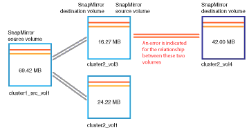

= Behebung von Verzögerungsproblemen in Active IQ Unified Manager
:allow-uri-read: 
:icons: font
:imagesdir: ../media/

[role="lead"]
Dieser Workflow zeigt beispielhaft, wie Sie ein Verzögerungsproblem beheben können. In diesem Szenario sind Sie Administrator oder Operator und greifen auf die Unified ManagerDashboard Seite zu, um zu prüfen, ob Probleme mit Ihren Schutzbeziehungen bestehen und gegebenenfalls Lösungen zu finden.

.Bevor Sie beginnen
Die Rolle Application Administrator oder Storage Administrator ist erforderlich.

Auf der Dashboard-Seite sehen Sie im Bereich „Ungelöste Incidents und Risiken“ im Bereich „Schutz“ unter „Schutzrisiken“ einen SnapMirror Lag-Fehler.

.Schritte
. Im Bereich *Schutz* auf der Seite *Dashboard* den Verzögerungsfehler der SnapMirror Beziehung suchen und anklicken.
+
Die Seite mit den Ereignisdetails für das Lag-Fehlerereignis erscheint.

. Auf der Detailseite *Event* können Sie eine oder mehrere der folgenden Aufgaben ausführen:
+
** Anhand der Fehlermeldung im Feld „Ursache“ des Zusammenfassungsbereichs lässt sich feststellen, ob eine Korrekturmaßnahme vorgeschlagen wird.
** Im Feld „Quelle“ des Bereichs „Zusammenfassung“ kann der Objektname, in diesem Fall ein Volume, ausgewählt werden, um Details zu diesem Volume zu erhalten.
** Möglicherweise wurden diesem Ereignis Notizen hinzugefügt.
** Dem Ereignis eine Notiz hinzufügen.
** Zuweisung des Ereignisses an einen bestimmten Benutzer.
** Das Ereignis bestätigen oder beheben.

. In diesem Szenario klicken Sie im Feld „Quelle“ des Bereichs *Summary* auf den Objektnamen (in diesem Fall ein Volume), um Details zum Volume zu erhalten.
+
Die Registerkarte „Schutz“ der Seite „Volume/Health-Details“ wird angezeigt.

. Auf der Registerkarte *Schutz* sehen Sie das Topologiediagramm.
+
Sie stellen fest, dass das Volume mit dem Lag-Fehler das letzte Volume in einer dreistufigen SnapMirror Kaskade ist. Das von Ihnen ausgewählte Volume ist dunkelgrau umrandet, und eine doppelte orange Linie vom Quell-Volume zeigt einen Fehler in der SnapMirror Beziehung an.

+

. Jedes der Volumes in der SnapMirror Kaskade auswählen.
+
Wenn Sie jedes Volume auswählen, ändern sich die Schutzinformationen in den Bereichen Zusammenfassung, Topologie, Verlauf, Ereignisse, Zugehörige Geräte und Zugehörige Warnungen und zeigen Details an, die für das ausgewählte Volume relevant sind.

. Im Bereich *Zusammenfassung* liegt der Cursor für jedes Volume über dem Informationssymbol im Feld *Aktualisierungsplan*.
+
In diesem Szenario stellen Sie fest, dass die SnapMirror Richtlinie DPDefault lautet und der SnapMirror Zeitplan stündlich fünf Minuten nach der vollen Stunde aktualisiert wird. Sie stellen fest, dass alle Volumes in der Beziehung versuchen, gleichzeitig einen SnapMirror Transfer abzuschließen.

. Zur Behebung des Verzögerungsproblems werden die Zeitpläne für zwei der kaskadierten Volumes so geändert, dass jedes Ziel eine SnapMirror Übertragung startet, nachdem seine Quelle eine Übertragung abgeschlossen hat.

