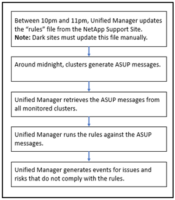

= Wie Active IQ Unified Manager Active IQ-Plattformereignisse generiert
:allow-uri-read: 
:icons: font
:imagesdir: ../media/

[role="lead"]
Vorfälle und Risiken der Active IQ Plattform werden wie im folgenden Diagramm gezeigt in Unified Manager Ereignisse umgewandelt.

Wie Sie sehen können, wird die auf der Active IQ Plattform kompilierte Regeldatei stets aktuell gehalten, Cluster AutoSupport Meldungen werden täglich generiert, und Unified Manager aktualisiert die Liste der Ereignisse täglich.
