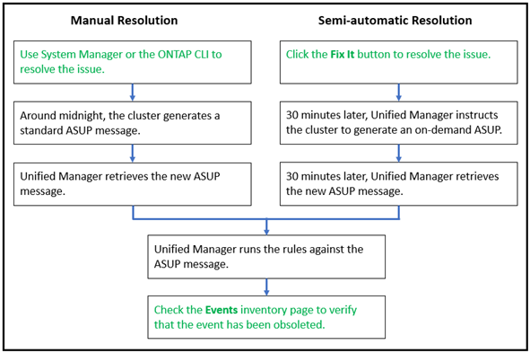

= Active IQ Plattformereignisse in Active IQ Unified Manager beheben
:allow-uri-read: 
:icons: font
:imagesdir: ../media/

[role="lead"]
Vorfälle und Risiken der Active IQ Plattform ähneln anderen Unified Manager Ereignissen, da sie anderen Benutzern zur Behebung zugewiesen werden können und dieselben verfügbaren Status aufweisen. Wenn diese Ereignisse jedoch mit der Schaltfläche *Fix It* behoben werden, kann die Behebung innerhalb weniger Stunden überprüft werden.

Das folgende Diagramm zeigt die Maßnahmen, die Sie ergreifen müssen (grün), und die Maßnahmen, die Unified Manager ergreift (schwarz), wenn Ereignisse behoben werden, die von der Active IQ Plattform generiert wurden.

Bei einer manuellen Behebung müssen Sie sich bei System Manager oder der ONTAP Befehlszeilenschnittstelle anmelden, um das Problem zu beheben. Die Überprüfung des Problems ist erst möglich, nachdem der Cluster um Mitternacht eine neue AutoSupport Meldung generiert hat.

Bei einer halbautomatischen Behebung mithilfe der Schaltfläche *Fix It* können Sie innerhalb weniger Stunden überprüfen, ob die Behebung erfolgreich war.
