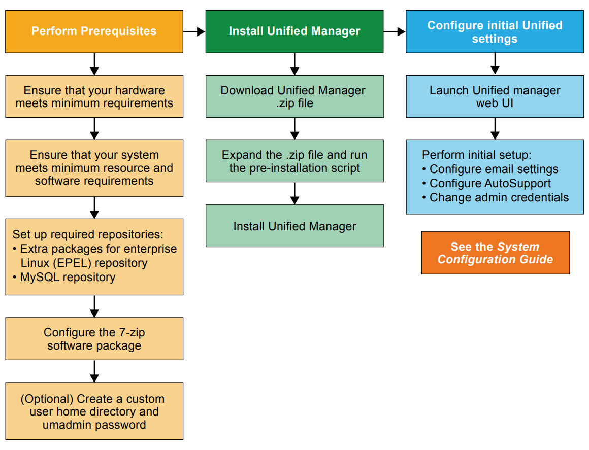

= Die Installationsreihenfolge für Active IQ Unified Manager auf Red Hat Enterprise Linux
:allow-uri-read: 
:icons: font
:imagesdir: ../media/

[role="lead"]
Der Installationsablauf beschreibt die Aufgaben, die Sie ausführen müssen, bevor Sie Unified Manager verwenden können.

