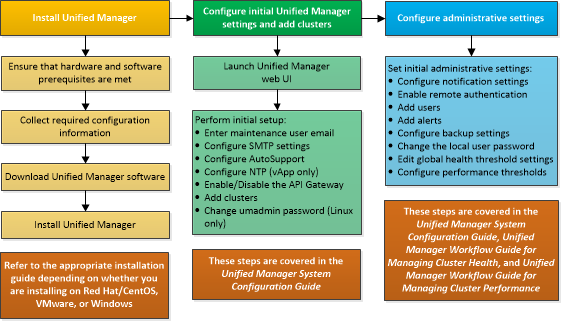

= Informationen zur Installationsreihenfolge von Active IQ Unified Manager
:allow-uri-read: 
:icons: font
:imagesdir: ../media/

[role="lead"]
Der Installationsablauf beschreibt die Aufgaben, die Sie ausführen müssen, bevor Sie Unified Manager verwenden können.

Diese Abschnitte beschreiben die einzelnen Elemente des unten dargestellten Arbeitsablaufs.

