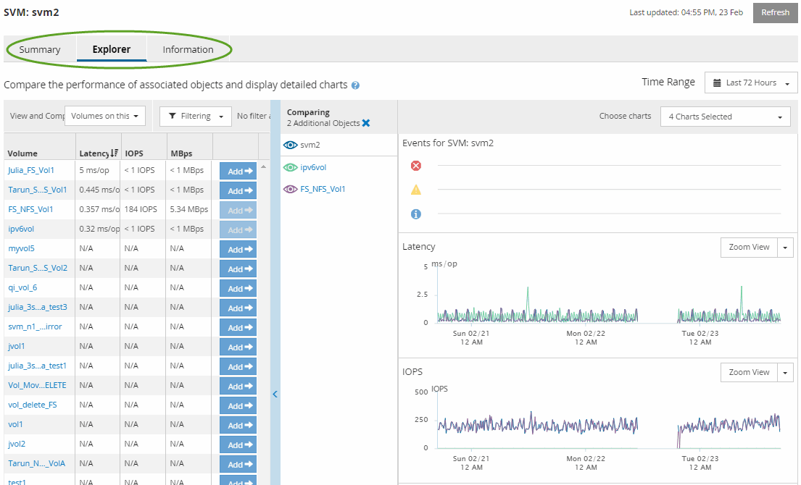

= Die Komponenten der Object Landing pages in Active IQ Unified Manager im Überblick
:allow-uri-read: 
:icons: font
:imagesdir: ../media/

[role="lead"]
Die Objektübersichtsseiten liefern Details zu allen kritischen, Warn- und Informationsereignissen. Sie bieten einen detaillierten Überblick über die Performance aller Clusterobjekte und ermöglichen es Ihnen, einzelne Objekte über verschiedene Zeiträume hinweg auszuwählen und zu vergleichen.

Die Objekt-Landingpages ermöglichen die Untersuchung der Gesamt-Performance aller Objekte sowie den Vergleich von Objekt-Performance-Daten in einem übersichtlichen Nebeneinanderformat. Dies ist bei der Bewertung der Performance und bei der Fehlerbehebung hilfreich.

[NOTE]
====
Die in den Zählerübersichtsfeldern und Zählerdiagrammen angezeigten Daten basieren auf einem Fünf-Minuten-Stichprobenintervall. Die im Objektinventarraster auf der linken Seite der Seite angezeigten Daten basieren auf einem einstündigen Stichprobenintervall.

====
Das folgende Bild zeigt ein Beispiel für eine Objekt-Landingpage mit den Explorer-Informationen:

Je nach dem angezeigten Storage Objekt kann die Objektübersichtsseite die folgenden Registerkarten enthalten, die Performance Daten zu dem Objekt bereitstellen:

* Zusammenfassung
+
Die Anzeige umfasst drei oder vier Zählerdiagramme, die die Ereignisse und die Performance pro Objekt für den vorangegangenen Zeitraum von 72 Stunden enthalten, einschließlich einer Trendlinie, die die Höchst- und Tiefstwerte während dieses Zeitraums anzeigt.

* Explorer
+
Zeigt ein Raster von Storage-Objekten an, die mit dem aktuellen Objekt verknüpft sind, wodurch sich die Performance-Werte des aktuellen Objekts mit denen der verknüpften Objekte vergleichen lassen. Diese Registerkarte enthält bis zu elf Zählerdiagramme und eine Zeitbereichsauswahl, mit denen sich verschiedene Vergleiche durchführen lassen.

* Informationen
+
Zeigt Werte für Konfigurationsattribute des Storage-Objekts an, die nicht die Performance betreffen, einschließlich der installierten Version der ONTAP-Software, des Namens des HA-Partners sowie der Anzahl der Ports und LIFs.

* Spitzenleister
+
Für Cluster: Zeigt die Storage Objekte mit der höchsten bzw. niedrigsten Performance an, basierend auf dem von Ihnen ausgewählten Performance-Zähler.

* Failover-Planung
+
Für Knoten: Zeigt die geschätzte Auswirkung auf die Performance eines Knotens an, wenn der HA-Partner des Knotens ausfällt.

* Details
+
Für Volumes: Zeigt detaillierte Performance-Statistiken für alle E/A-Aktivitäten und -Operationen der ausgewählten Volume-Workload an. Diese Registerkarte ist für FlexVol Volumes, FlexGroup Volumes und Bestandteile von FlexGroups verfügbar.

