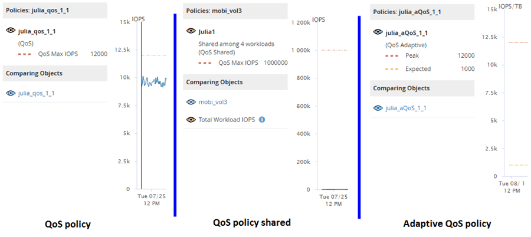

= QoS-Richtlinien in Durchsatzdiagrammen mit Active IQ Unified Manager anzeigen
:allow-uri-read: 
:icons: font
:imagesdir: ../media/

[role="lead"]
Die von ONTAP definierten QoS-Richtlinieneinstellungen (Quality of Service), die auf ein Volume oder eine LUN angewendet wurden, lassen sich im Performance Explorer sowie in den Workload Analysis-Diagrammen für IOPS, IOPS/TB und MB/s anzeigen. Die in den Diagrammen angezeigten Informationen unterscheiden sich je nach Typ der QoS-Richtlinie, die auf die Workload angewendet wurde.

Die Einstellung „Durchsatzmaximum“ (oder „`peak`“) definiert den maximalen Durchsatz, den die Arbeitslast belegen kann, und begrenzt dadurch die Auswirkungen auf konkurrierende Arbeitslasten hinsichtlich der Systemressourcen. Die Einstellung „Durchsatzminimum“ (oder „`expected`“) definiert den minimalen Durchsatz, der der Arbeitslast zur Verfügung stehen muss, damit eine kritische Arbeitslast die Mindestdurchsatzziele unabhängig von der Nachfrage konkurrierender Arbeitslasten erreicht.

Gemeinsame und nicht gemeinsam genutzte QoS-Richtlinien für IOPS und MB/s verwenden die Begriffe „`minimum`“ und „`maximum`“, um die Unter- und Obergrenze zu definieren. Adaptive QoS-Richtlinien für IOPS/TB, die in ONTAP 9.3 eingeführt wurden, verwenden die Begriffe „`expected`“ und „`peak`“, um die Unter- und Obergrenze zu definieren.

Mit ONTAP lassen sich diese beiden Arten von QoS-Richtlinien erstellen. Je nachdem, wie sie auf Workloads angewendet werden, wird die QoS-Richtlinie in den Performance-Diagrammen auf drei Arten angezeigt.

|===
| Typ der Richtlinie | Funktionalität | Indikator in der Unified Manager-Schnittstelle 

 a| 
Einem einzelnen Workload zugewiesene gemeinsam genutzte QoS-Richtlinie oder einem einzelnen Workload oder mehreren Workloads zugewiesene nicht gemeinsam genutzte QoS-Richtlinie
 a| 
Jede Arbeitslast kann die angegebene Durchsatzeinstellung nutzen
 a| 
Zeigt "`(QoS)`" an

 a| 
Gemeinsame QoS-Richtlinie, die mehreren Workloads zugewiesen ist
 a| 
Alle Workloads teilen sich die angegebene Durchsatzeinstellung
 a| 
Zeigt "`(QoS Shared)`" an

 a| 
Adaptive QoS-Richtlinie, die einer einzelnen oder mehreren Arbeitslasten zugewiesen ist
 a| 
Jede Arbeitslast kann die angegebene Durchsatzeinstellung nutzen
 a| 
Zeigt "`(QoS Adaptive)`" an

|===
Die folgende Abbildung zeigt ein Beispiel dafür, wie die drei Optionen in den Zählerdiagrammen dargestellt werden.

Wenn eine normale QoS-Richtlinie, die in IOPS definiert wurde, im IOPS/TB-Diagramm für eine Arbeitslast angezeigt wird, konvertiert ONTAP den IOPS-Wert in einen IOPS/TB-Wert, und Unified Manager zeigt diese Richtlinie im IOPS/TB-Diagramm zusammen mit dem Text "`QoS, defined in IOPS`" an.

Wenn eine adaptive QoS-Richtlinie, die in IOPS/TB definiert wurde, im IOPS-Diagramm für eine Arbeitslast angezeigt wird, konvertiert ONTAP den IOPS/TB-Wert in einen IOPS-Wert, und Unified Manager zeigt diese Richtlinie im IOPS-Diagramm zusammen mit dem Text „QoS Adaptive - Used, defined in IOPS/TB“ oder „QoS Adaptive - Allocated, defined in IOPS/TB“ an, je nachdem, wie die Einstellung für die Peak-IOPS-Zuweisung konfiguriert ist. Wenn die Zuweisungseinstellung auf „allocated-space“ gesetzt ist, werden die Peak-IOPS anhand der Größe des Volume berechnet. Wenn die Zuweisungseinstellung auf „used-space“ gesetzt ist, werden die Peak-IOPS anhand der im Volume gespeicherten Datenmenge unter Berücksichtigung von Storage-Effizienzen berechnet.

[NOTE]
====
Das IOPS/TB-Diagramm zeigt Performance Daten nur dann an, wenn die vom Volume genutzte logische Kapazität mindestens 128 GB beträgt. Im Diagramm werden Lücken angezeigt, wenn die genutzte Kapazität im ausgewählten Zeitraum unter 128 GB fällt.

====