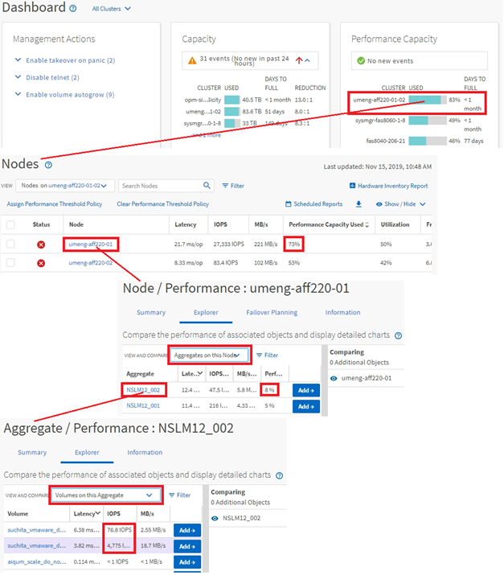

= Überwachung der Clusterobjektnavigation in Active IQ Unified Manager
:allow-uri-read: 
:icons: font
:imagesdir: ../media/

[role="lead"]
Sie können die Performance aller Objekte in jedem von Unified Manager verwalteten Cluster überwachen. Die Überwachung Ihrer Storage Objekte bietet Ihnen einen Überblick über die Cluster- und Objekt-Performance und umfasst auch die Überwachung von Performance-Ereignissen. Sie können Performance und Ereignisse auf einer hohen Ebene anzeigen oder weitere Details zur Objekt-Performance und zu Performance-Ereignissen untersuchen.

Dies ist ein Beispiel für viele mögliche Navigationen zu Clusterobjekten:

. Auf der Dashboard-Seite können Sie die Details im Bereich „Performance-Kapazität“ prüfen, um den Cluster zu identifizieren, der die meiste Performance-Kapazität nutzt, und durch Klicken auf das Balkendiagramm zur Liste der Knoten für diesen Cluster navigieren.
. Der Knoten mit dem höchsten Wert der genutzten Performance-Kapazität ist zu identifizieren und anzuklicken.
. Auf der Seite „Node / Performance Explorer“ steht im Menü „View and Compare“ die Option *Aggregates on this Node* zur Auswahl.
. Das Aggregat, das die meiste Performance-Kapazität nutzt, ist zu identifizieren und anzuklicken.
. Auf der Seite „Aggregate / Performance Explorer“ erfolgt im Menü „View and Compare“ ein Klick auf *Volumes on this Aggregate*.
. Sie können die Volumes mit den meisten IOPS ermitteln.

Bei diesen Volumes sollte geprüft werden, ob eine QoS-Richtlinie oder eine Performance Service Level Richtlinie angewendet oder die Richtlinieneinstellungen geändert werden sollten, damit diese Volumes nicht einen so großen Prozentsatz der IOPS im Cluster beanspruchen.

