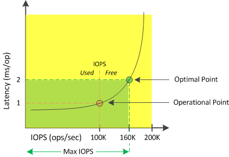

= Verfügbare IOPS in Active IQ Unified Manager
:allow-uri-read: 
:icons: font
:imagesdir: ../media/

[role="lead"]
Der verfügbare IOPS-Zähler gibt die verbleibende Anzahl an IOPS an, die sich einem Knoten oder einem Aggregat hinzufügen lässt, bevor die Ressource ihr Limit erreicht.

Die gesamten IOPS, die ein Knoten bereitstellen kann, basieren auf den physischen Eigenschaften des Knotens, z. B. auf der Anzahl der CPUs, der CPU-Geschwindigkeit und der Menge an RAM. Die gesamten IOPS, die ein Aggregat bereitstellen kann, basieren auf den physischen Eigenschaften der Festplatten, z. B. auf einer SATA-, SAS- oder SSD-Festplatte.

Die Summe der IOPS aller Volumes eines Aggregats entspricht möglicherweise nicht der Summe der IOPS des Aggregats. Dies wird im folgenden Knowledge-Base-Artikel erläutert: KB link:https://kb.netapp.com/Advice_and_Troubleshooting/Data_Infrastructure_Management/Active_IQ_Unified_Manager/Why_does_the_sum_of_all_volume_IOPs_in_an_aggregate_not_match_the_aggregate_IOPs%3F["Warum stimmt die Summe aller Volume-IOPs in einem Aggregat nicht mit den IOPs des Aggregats überein?"]

Während der Zähler für freie Performance-Kapazität den Prozentsatz einer Ressource angibt, der noch verfügbar ist, zeigt der Zähler für verfügbare IOPS die genaue Anzahl von IOPS (Workloads) an, die einer Ressource hinzugefügt werden können, bevor die maximale Performance-Kapazität erreicht ist.

Wenn Sie beispielsweise ein Paar der Storage-Systeme FAS2520 und FAS8060 verwenden, bedeutet ein Wert von 30 % für die freie Performance-Kapazität, dass noch freie Performance-Kapazität vorhanden ist. Dieser Wert gibt jedoch keine Transparenz darüber, wie viele weitere Workloads Sie auf diesen Nodes noch einsetzen können. Der Zähler für verfügbare IOPS zeigt möglicherweise, dass auf dem FAS8060 500 IOPS verfügbar sind, auf dem FAS2520 jedoch nur 100.

Die folgende Abbildung zeigt eine Beispielkurve für Latenz gegenüber IOPS für einen Knoten.

Die maximale Anzahl von IOPS, die eine Ressource bereitstellen kann, ist die Anzahl von IOPS, wenn der Zähler für die genutzte Performance-Kapazität bei 100 % liegt (der optimale Punkt). Der Betriebspunkt zeigt an, dass der Knoten derzeit mit 100K IOPS bei einer Latenz von 1.0 ms/op arbeitet. Auf Grundlage der vom Knoten erfassten Statistiken ermittelt Unified Manager, dass die maximalen IOPS für den Knoten 160K betragen, was bedeutet, dass 60K IOPS frei oder verfügbar sind. Daher können diesem Knoten weitere Workloads hinzugefügt werden, damit Ihre Systeme effizienter genutzt werden.

[NOTE]
====
Bei minimaler Benutzeraktivität in der Ressource wird der verfügbare IOPS-Wert anhand einer generischen Arbeitslast auf Basis von ungefähr 4.500 IOPS pro CPU-Kern berechnet. Dies liegt daran, dass Unified Manager nicht über die erforderlichen Daten verfügt, um die Eigenschaften der bereitgestellten Arbeitslast genau zu schätzen.

====