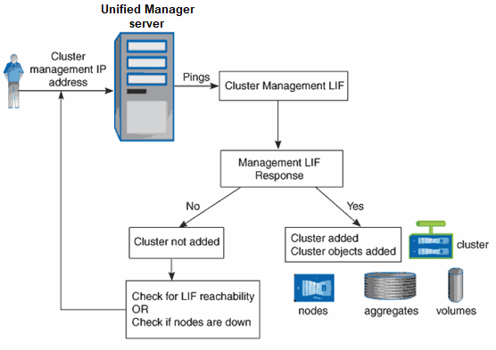

= Informationen zur Funktionsweise des Cluster-Erkennungsprozesses in Active IQ Unified Manager
:allow-uri-read: 
:icons: font
:imagesdir: ../media/

[role="lead"]
Nachdem Sie einen Cluster zu Unified Manager hinzugefügt haben, erkennt der Server die Clusterobjekte und fügt sie seiner Datenbank hinzu. Das Verständnis der Funktionsweise dieses Erkennungsprozesses unterstützt Sie beim Managen der Cluster Ihres Unternehmens und ihrer Objekte.

Das Überwachungsintervall für die Erfassung von Clusterkonfigurationsinformationen beträgt 15 Minuten. Nachdem Sie beispielsweise einen Cluster hinzugefügt haben, dauert es 15 Minuten, bis die Clusterobjekte in der Unified Manager UI angezeigt werden. Dieser Zeitraum gilt auch für Änderungen an einem Cluster. Wenn Sie beispielsweise zwei neue Volumes zu einer SVM in einem Cluster hinzufügen, werden diese neuen Objekte nach dem nächsten Abfrageintervall, das bis zu 15 Minuten betragen kann, in der UI angezeigt.

Die folgende Abbildung veranschaulicht den Entdeckungsprozess:

Nachdem alle Objekte für einen neuen Cluster erkannt wurden, beginnt Unified Manager mit der Erfassung historischer Performance-Daten der letzten 15 Tage. Diese Statistiken werden mithilfe der Funktion zur Erfassung der Datenkontinuität gesammelt. Diese Funktion stellt Ihnen unmittelbar nach dem Hinzufügen eines Clusters Performance-Informationen für mehr als zwei Wochen zur Verfügung. Nach Abschluss des Erfassungszyklus für die Datenkontinuität werden standardmäßig alle fünf Minuten Echtzeit-Performance-Daten für den Cluster erfasst.

[NOTE]
====
Da die Erfassung von 15 Tagen Performance-Daten CPU-intensiv ist, wird empfohlen, die Hinzufügung neuer Cluster zeitlich zu staffeln, damit die Abfragen zur Erfassung der Datenkontinuität nicht gleichzeitig auf zu vielen Clustern ausgeführt werden.

====